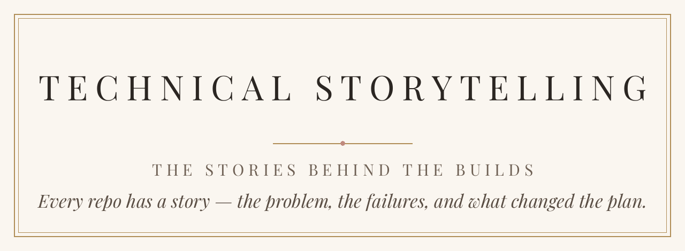
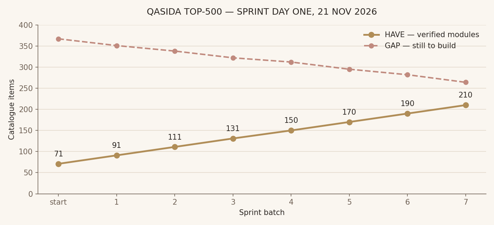
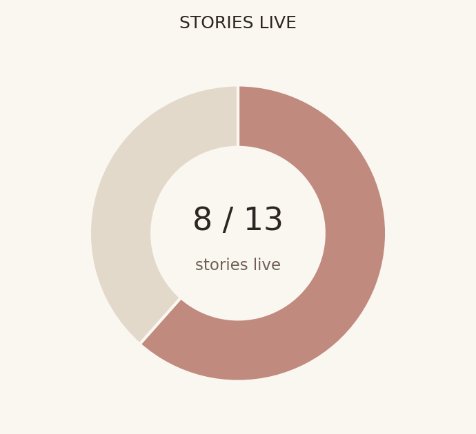

The story behind my work. Not the README version — the real version: what the problem actually was, what I decided and why, what failed, what I learned, and how the plan changed along the way.

I tell every story here the same way:

1. **The problem** — what was actually wrong, in plain words.
2. **Design decisions** — what I chose, and why, with the trade-offs stated.
3. **Failed attempts** — what didn't work, with specifics. The failures are the story.
4. **Lessons** — what the failures taught, stated as rules I now follow.
5. **What changed the plan** — how the goal, the design, or the schedule moved because of what happened.

## BY THE NUMBERS

*Qasida Top-500, sprint day one — verified counts from the push log, 21 Nov 2026. The Qasida story itself is date-stamped the same day.*

## THE HONESTY RULE

Nothing in these stories is invented. Every number, date, decision and failure comes from a source — the project repo, the local work tree, the notes, or the paper — and each story lists its sources at the end. Where the record ends, the story says so, marked as a gap I still need to write, like **[I still need to write this part — …]**. Those gaps are mine to fill in, not anyone's to guess.

## STORIES

| # | Story | What it's about | Status |
|---|---|---|---|
| 01 | [Provenance-Aware Belief Aggregation](stories/01-provenance-aware-belief-aggregation/STORY.md) | My research paper — it started from a paradox and ended as a proof that trust weights cannot decode conventions, then survived an audit that narrowed its central theorem | Live |
| 02 | [Qasida](stories/02-red-moon-qasida/STORY.md) | My programming language, built problem-first: self-hosting, the speed program, three fixes, a 2.3.0 release, and a sprint week — status as of 21 Nov 2026 | Live |
| 03 | [big32](stories/03-big-32/STORY.md) | My 32-bit RISC-V CPU and the Step 34 stall: a real virtio bug that wasn't the cause, and the driver that was | Live |
| 04 | [MOON-OS](stories/04-moon-os/STORY.md) | An operating system I wrote in Qasida, the daily-ten cadence, and a kernel that hit a hard size wall | Live |
| 05 | [OpenMythos](stories/05-openmythos-rlm/STORY.md) | A language model I built from scratch: the 44M run that falsified its own hypothesis, three one-day failures, and the 1B plan they shaped | Live |
| 06 | [Recurrent Small Language Models](stories/06-recurrent-small-lms/STORY.md) | The loop-depth sweep that proved a negative result — and the report I had to fix three times before it was honest | Live |
| 07 | [The ASIC Puzzle](stories/07-asic-puzzle-2026-solution/STORY.md) | I reversed a chip from its layout alone, four methods in parallel, a key proved unique — and a submission that was impossible from the start | Live |
| 08 | [TINY8](stories/08-tiny8/STORY.md) | My 8-bit CPU in six versions in one night, and the wall that sent the work to a 32-bit core instead | Live |

## COMING LATER

These repos don't have stories yet — not because they aren't interesting, but because a story here needs a documented arc: a problem, real decisions, real failures, real turning points. Where the history is thin, I don't write a filler story. They land when the record supports them.

- **harshswarm-** — the multi-agent swarm
- **BLACK-MOON-OS-** — the Linux distro
- **qasida-tmLanguage** — the editor grammar
- **themythofsisyphusjayant** — the GitHub profile itself
- **TECHNICAL-STORYTELLING--JAYANT-BRAIN-** — this repo, once the others exist

## WRITING A NEW STORY

When I write a new story, I use [stories/TEMPLATE.md](stories/TEMPLATE.md). Same five-part shape, same honesty rule: I source everything, mark what I don't know, never invent.
